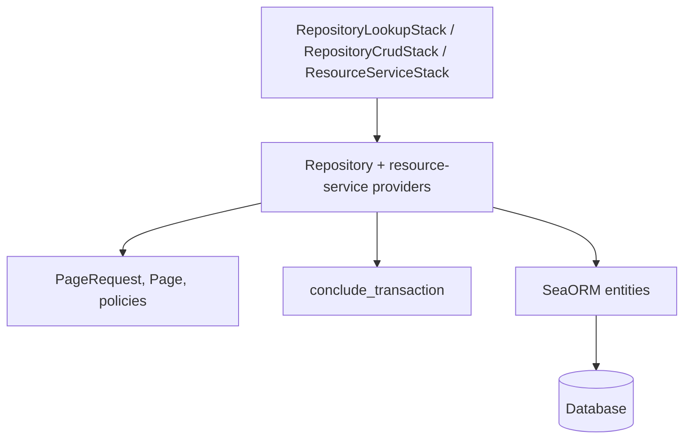

# cgp-orm architecture

`cgp-orm` is a transport-independent SeaORM repository and resource-service
layer wired with [cgp-fork](https://crates.io/crates/cgp-fork). Contexts
choose entities, codecs, identity policies, and error maps through CGP
presets. This crate does not depend on a transport stack or a domain model.

**Presets compose behavior; contexts choose policies.**

# Layers



# Primary keys

```rust
pub type PrimaryKeyOf<C> =
    <<<C as HasEntityType>::Entity as EntityTrait>::PrimaryKey as PrimaryKeyTrait>::ValueType;
```

`get_by_id` / `delete_by_id` take this type. Helpers in `util` read and
write **every** key column; `merge_update` never copies PK fields.

# Identity

`CanBuildIdentityCondition` builds the lookup `Condition`.
`UniqueColumnsIdentity` ANDs `HasUniqueColumns::unique_columns`. The
identity used by `get_or_create` must match a database unique constraint.

# Write semantics

- `get_or_create` — select by identity; on miss insert; on unique conflict
  roll back and re-fetch.
- `upsert` — find by identity; hit → merge-update, miss → insert; on
  concurrent unique conflict roll back and merge-update on a new txn.
- `conclude_transaction` never swallows the original error on a failed
  rollback.

# Stacks

Compose with `cgp_preset!` using `RepositoryLookupStack`,
`RepositoryCrudStack`, and `ResourceServiceStack`. Component keys use
`cgp_orm::components::…` paths so a preset can be replayed outside this
crate.

# Unique-conflict detection

Policy is a CGP component. Default: `StandardUniqueConflict`
(`sql_err` → `RecordNotInserted` → message fallback). Alternatives:
`SqlErrUniqueConflict`, backend-specific matchers, `MessageUniqueConflict`,
`OrUniqueConflict<A, B>`.

# Filters

`CanBuildEntityFilter` supplies the WHERE for `paginate` and is ANDed onto
`find_by_identity`. Default `NoEntityFilter` returns `Condition::all()`.
There is no library `DeletionPolicy`.

Cursor/keyset pagination is not implemented; offset `PageRequest` remains
the API.
