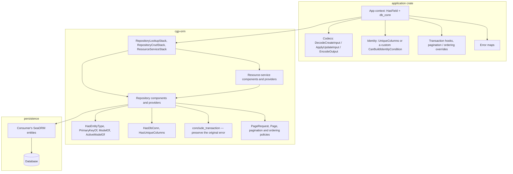
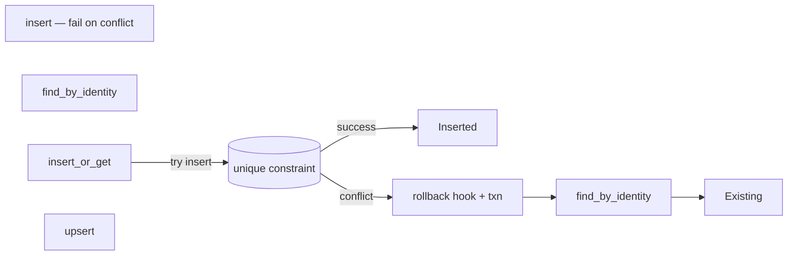
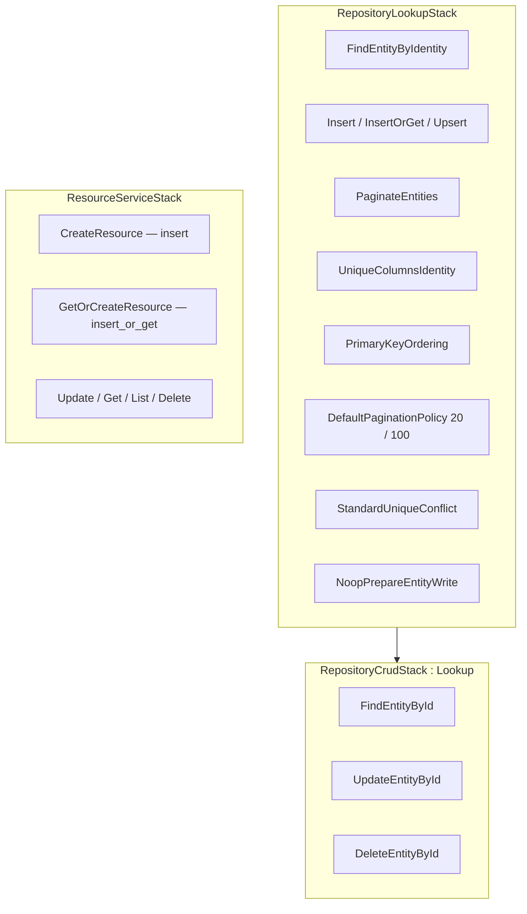

# cgp-orm architecture

`cgp-orm` is a transport-independent SeaORM repository and resource-service
layer wired with [cgp-fork](https://crates.io/crates/cgp-fork). Application
crates choose entities, codecs, identity policies, and error maps. This
crate never depends on a transport stack or a particular domain model.

The design principle: **presets compose behavior, contexts choose policies,
and macros do not own architecture.**

# Layers



# Primary keys

```rust
pub type PrimaryKeyOf<C> =
    <<<C as HasEntityType>::Entity as EntityTrait>::PrimaryKey as PrimaryKeyTrait>::ValueType;
```

`find_by_id` and `delete_by_id` take this type directly. There is no
`From<i32>` bound and no `primary_key_column()` helper that returns only
the first key. Helpers in `util`:

- `primary_key_from_active_model` — reads **every** key column.
- `set_primary_key_on_active_model` — writes every key column.
- `merge_update` — copies `ActiveValue::Set` fields, **excluding all
  primary-key columns**.
- `is_primary_key_column` — membership test by identifier, not position.

# Identity

The public identity API is:

```rust
trait CanBuildIdentityCondition {
    fn identity_condition(
        &self,
        model: &ActiveModelOf<Self>,
    ) -> Result<Condition, Error>;
}
```

`UniqueColumnsIdentity` is the reusable implementation: it `AND`s
equality predicates for `HasUniqueColumns::unique_columns`. An empty
list raises `ErrIdentityEmpty`; a `NotSet` field raises
`ErrIdentityFieldUnset`. Contexts with a more complex identity
(disjunctions, expressions, partial uniques) implement the trait
themselves and override `IdentityConditionBuilderComponent`.

The identity used by `insert_or_get` must match a **database unique
constraint**. The provider does not invent one.

# Write semantics

There is no generic `find_or_insert` that pretends a transaction around
find-then-insert is atomic.



- `insert_or_get` attempts the insert (after the write hook) inside a
  transaction. On a unique-constraint violation it rolls the transaction
  back — so hook side effects are undone — and fetches by identity on a
  clean connection. This is required on PostgreSQL, which aborts a
  transaction after a unique violation.
- `upsert` finds by identity; on a hit it merge-updates, on a miss it
  inserts, and on a concurrent unique conflict it fetches and updates.
- `conclude_transaction` never uses `?` on rollback. If rollback also
  fails, the original operation error is still the one returned. See
  `transaction::conclude` (unit-tested, including a failed rollback)
  and the SQLite test where a failing write hook is rolled back and the
  hook's error is what the caller observes.

# Stacks



An application composes them explicitly:

```rust,ignore
cgp_preset! {
    PostBase: RepositoryCrudStack + ResourceServiceStack {
        EntityTypeProviderComponent: UseType<post::Entity>,
        CreateInputTypeProviderComponent: UseType<CreatePost>,
        UpdateInputTypeProviderComponent: UseType<UpdatePost>,
        OutputTypeProviderComponent: UseType<PostOutput>,
        // codecs, identity, and hooks
    }
}
```

Component keys in the stacks use `cgp_orm::components::…` paths so a
consumer crate can replay the preset (a `crate::` path would resolve in
the consumer, not in this crate).


# Unique-conflict detection

The policy is a CGP component, not a hardcoded string match.

| Provider | What it uses |
| --- | --- |
| `StandardUniqueConflict` (default) | `DbErr::sql_err()`, then `RecordNotInserted`, then multi-backend messages |
| `SqlErrUniqueConflict` | `DbErr::sql_err()` only (needs a sqlx/rusqlite feature) |
| `SqliteUniqueConflict` | `sql_err` + SQLite unique/PK phrases (not FK/CHECK) |
| `PostgresUniqueConflict` | `sql_err` + `23505` / `unique violation` |
| `MysqlUniqueConflict` | `sql_err` + `Duplicate entry` / `error 1062` |
| `MessageUniqueConflict` | Multi-backend messages only |
| `OrUniqueConflict<A, B>` | Disjunction of two policies |

`DbErr::sql_err()` is the accurate, backend-agnostic path. It is
feature-gated inside SeaORM: it returns `Some(UniqueConstraintViolation)`
only when a `sqlx-*` or `rusqlite` feature is enabled (feature
unification with the application crate is enough; this crate does not
force those features). The message fallback is a conservative heuristic
and is covered by unit tests for both positive phrases and
foreign-key/check false positives.

# Service layer

`HasCreateInputType`, `HasUpdateInputType`, and `HasOutputType` are
associated types chosen by the context. A consumer can map all three to
one shared DTO, or use distinct request and response types.

`CanCreateResource::create` uses `insert` (conflicts are errors).
`CanGetOrCreateResource::get_or_create` uses `insert_or_get`. The
latter is the correct replacement for a historical "create via
find-or-insert".

# Pagination and cursor extension

`PageRequest { page, size }` is 1-based and always policy-clamped.
Ordering is required and defaults to every primary-key column,
ascending.

**Cursor pagination (not implemented).** A future

```rust,ignore
pub struct CursorRequest<Cursor> {
    pub after: Option<Cursor>,
    pub size: u64,
}

#[cgp_component]
pub trait CanPaginateEntitiesByCursor { /* … */ }
```

can sit beside `PageRequest` without changing the offset API. The
existing ordering policy is already the prerequisite for a stable
keyset.

# What is deliberately absent

The following belong in an application crate, not here:

- Transport codecs and wire error types
- `i32` as a universal identifier
- Domain-specific identity or device-current behavior
- Entity names used as route segments
- Hardcoded source-error lists (error maps are application policy)
- Generated sibling contexts and a proc-macro that owns wiring

# Tests

`tests/sqlite.rs` runs against in-memory SQLite and covers:

- find / insert / update / delete by id (i32)
- a UUID-key entity
- a composite-key entity, including merge that leaves every PK column untouched
- `insert_or_get` under a real unique-constraint conflict
- `upsert` insert then update, with no second row
- pagination with deterministic PK order and max-size clamping (never 5)
- a failing write hook: the original error is returned and the row is
  rolled back

`transaction::conclude` is unit-tested for the case where rollback
itself also fails: the original error is still what `into_result`
returns.
